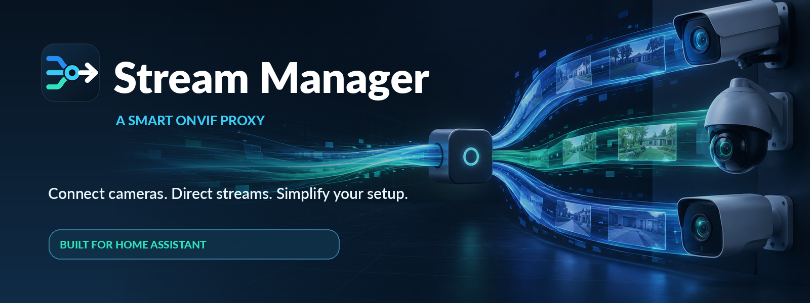
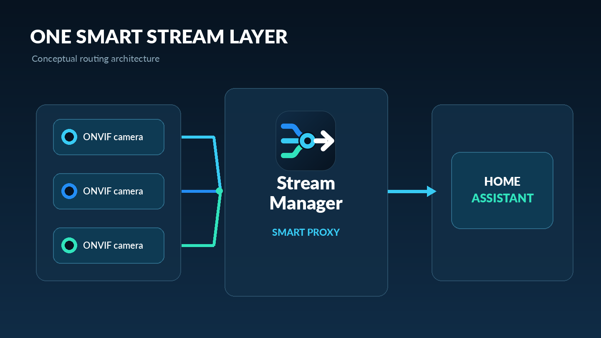
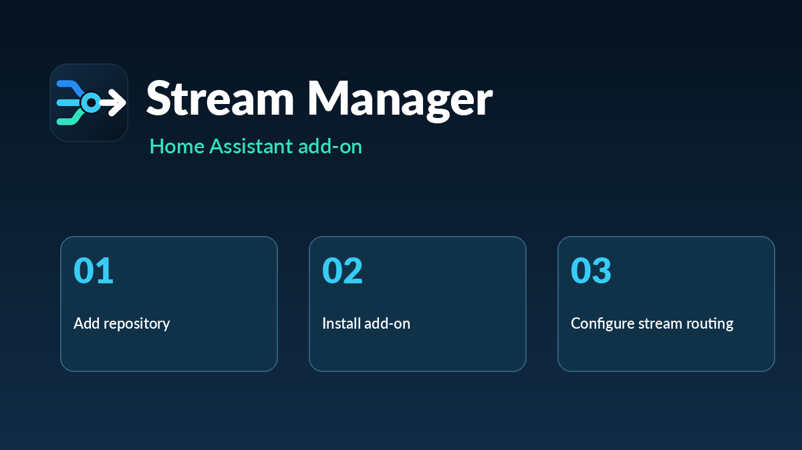

  

# Stream Manager

**Smart ONVIF proxy for Home Assistant.**

Stream Manager publishes a Home Assistant camera, an RTSP URL, an existing ONVIF stream, or a still image as one stable ONVIF camera. The RTSP and ONVIF addresses stay the same when the picture source changes. Optional rules switch that picture from a Home Assistant entity state: a live camera while a switch is on, and a still image while it is off.

  

## What it does

- Accepts an RTSP URL, a Home Assistant camera entity, an existing ONVIF device, or a still image.
- Advertises one ONVIF Profile S media profile, token `main`, on a network interface you choose.
- Keeps one RTSP URL and one ONVIF device URL. Changing the picture source does not change them.
- Can pull a source the host can reach on one network and announce the virtual camera on another interface.
- Encodes the published stream to the resolution, frame rate, bitrate, H.264 profile, and GOP you set, and reports those same values over ONVIF.
- Answers WS-Discovery on the selected IPv4 address.
- Includes a panel for cameras, rules, output settings, and the live addresses.

The panel is this add-on. go2rtc 1.9.14 is only the local RTSP engine. There is no Profile T, PTZ, events, or multicast RTP.

For a standalone Debian LXC deployment in Proxmox, see the [LXC installation guide](stream_manager/README.md#install-in-a-proxmox-lxc).

Stream Manager is an independent project. It is not affiliated with or endorsed by Home Assistant, the Open Home Foundation, or ONVIF.

## Install

In **Settings → Apps → Add-on store → ⋮ → Repositories**, add:

`https://github.com/zodyking/Stream-Manager`

Install **Stream Manager** and open its panel. The add-on uses the host network so discovery can answer on the interface you select.

  

The graphic is a visual guide. Use the repository URL above. Options, ports, and local setup are in [`stream_manager/README.md`](stream_manager/README.md).

## Brand

Logos, the add-on icon and logo, GitHub art, and design tokens live in [`Stream_Manager_Brand_Kit`](Stream_Manager_Brand_Kit).
